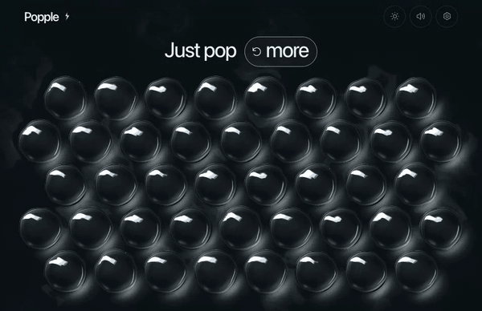
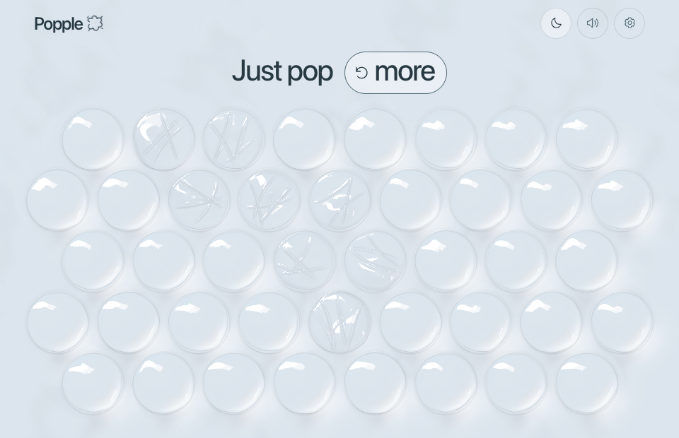
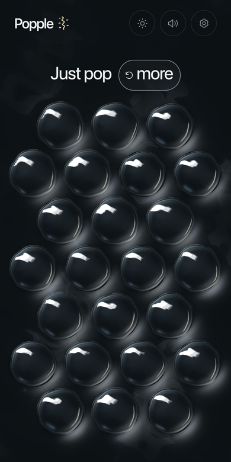
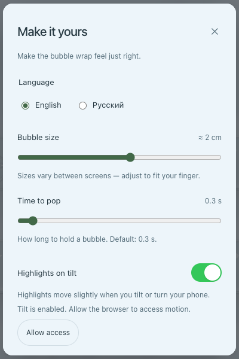
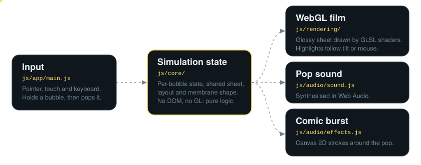

<div align="center">

<picture>
  <source media="(prefers-color-scheme: dark)" srcset="./readme-assets/banner-dark.svg">
  <source media="(prefers-color-scheme: light)" srcset="./readme-assets/banner-light.svg">
  
</picture>

<br>

**A small browser game where you pop bubble wrap. It looks glossy, sounds crisp, and needs nothing but static files.**

<br>

<a href="https://leamix.github.io/popple/">
  <picture>
    <source media="(prefers-color-scheme: dark)" srcset="./readme-assets/play-dark.svg">
    <source media="(prefers-color-scheme: light)" srcset="./readme-assets/play-light.svg">
    
  </picture>
</a>

<br>


<br>

[Quick start](#quick-start) &nbsp;•&nbsp;
[Features](#features) &nbsp;•&nbsp;
[How it works](#how-it-works) &nbsp;•&nbsp;
[Project layout](#project-layout) &nbsp;•&nbsp;
[Testing](#testing) &nbsp;•&nbsp;
[Demo](#demo)

</div>

<br>

<p align="center">
  
</p>

<picture>
  <source media="(prefers-color-scheme: dark)" srcset="./readme-assets/divider-dark.svg">
  <source media="(prefers-color-scheme: light)" srcset="./readme-assets/divider-light.svg">
  
</picture>

## What is Popple?

Popple is a static web app. You press and hold a bubble, and it pops with a sound and a short comic burst. The bubbles fill the whole screen and stay in place until you ask for a fresh sheet.

It is a prototype with a deliberately small footprint:

- No framework, no bundler, no `node_modules` at runtime.
- No back end, no database, no accounts. The server only hands out files.

<picture>
  <source media="(prefers-color-scheme: dark)" srcset="./readme-assets/divider-dark.svg">
  <source media="(prefers-color-scheme: light)" srcset="./readme-assets/divider-light.svg">
  
</picture>

## Quick start

You need [Node.js](https://nodejs.org/) 18 or newer. It is used only for the dev server and the tests.

```sh
npm start
```

Then open <http://localhost:4174>.

The server also prints a `Same Wi-Fi` address. Open it on your phone to try touch input, as long as the phone and the computer are on the same network.

| Variable      | Default   | What it does                                                    |
| ------------- | --------- | --------------------------------------------------------------- |
| `POPPLE_PORT` | `4174`    | Port for the dev server.                                        |
| `POPPLE_HOST` | `0.0.0.0` | Interface to listen on. Use `127.0.0.1` to stay on this machine. |

```sh
POPPLE_HOST=127.0.0.1 POPPLE_PORT=8080 npm start
```

> [!NOTE]
> Open the page through the server, not by double-clicking `index.html`. Browsers block ES module imports on `file://` URLs.

<picture>
  <source media="(prefers-color-scheme: dark)" srcset="./readme-assets/divider-dark.svg">
  <source media="(prefers-color-scheme: light)" srcset="./readme-assets/divider-light.svg">
  
</picture>

## Features

<table>
<tr>
<td width="50%" valign="top">

**🫧 Bubbles that fill the screen**<br>
The number of bubbles depends on the free area, so a phone and a wide monitor both get a full sheet. Rows are offset, like real bubble wrap.

**🤏 Press, hold, pop**<br>
A short press dents the bubble and lets it spring back. Holding long enough pops it. The hold time is adjustable from 0.2 s to 2 s.

**🔊 Synthesised sound**<br>
There are no audio files. Each pop is generated with Web Audio from five sound families (`snap`, `body`, `crinkle`, `tight`, `double`), and the same sound is not repeated twice in a row.

</td>
<td width="50%" valign="top">

**✨ Live highlights**<br>
The film is drawn with WebGL and GLSL shaders. Highlights follow the mouse, or tilt with your phone if you allow motion access. Highlights move, but the bubble shapes do not. Tilt works only on secure pages (HTTPS or `localhost`).

**🌗 Light and dark themes**<br>
Switch themes at any time. Popped bubbles stay popped.

**💥 Comic burst**<br>
A Canvas 2D layer draws short strokes around each pop. It sits above the film as a separate layer.

</td>
</tr>
</table>

### Accessibility and comfort

- **Real buttons.** Every bubble is a native HTML `<button>`. Hold <kbd>Space</kbd> or <kbd>Enter</kbd> to pop it with the keyboard.
- **Screen readers.** A live region announces state changes, for example `Pop! 3 of 42 bubbles popped.`
- **Reduced motion.** The game respects `prefers-reduced-motion`. It also has its own **Fewer effects** switch.
- **Sound and vibration.** Sound can be muted. Vibration is used only where the browser supports it.
- **Languages.** English and Russian. The choice is saved.
- **Saved settings.** Theme, sound, size, hold time, tilt and language are stored in `localStorage` under the `popple.` prefix. If storage is blocked, for example in a private window, the game still works.

<table>
<tr>
<td align="center" width="50%">
<br>
<sub>Light theme on desktop</sub>
</td>
<td align="center" width="25%">
<br>
<sub>Dark theme on a phone</sub>
</td>
<td align="center" width="25%">
<br>
<sub>Settings dialog</sub>
</td>
</tr>
</table>

<picture>
  <source media="(prefers-color-scheme: dark)" srcset="./readme-assets/divider-dark.svg">
  <source media="(prefers-color-scheme: light)" srcset="./readme-assets/divider-light.svg">
  
</picture>

## How it works

The code is split by responsibility. Input goes into simulation state. The state is then turned into pixels and sound.

<picture>
  <source media="(prefers-color-scheme: dark)" srcset="./readme-assets/architecture-dark.svg">
  <source media="(prefers-color-scheme: light)" srcset="./readme-assets/architecture-light.svg">
  
</picture>

| Layer | Folder | Job |
| ----- | ------ | --- |
| **Page** | [`public/index.html`](public/index.html), [`public/css/`](public/css) | Bubble buttons, settings dialog and two themes. |
| **Coordinator** | [`public/js/app/`](public/js/app) | Reads pointer, touch and keyboard input. Owns the frame loop and settings. Passes a pop event to sound and effects. |
| **State** | [`public/js/core/`](public/js/core) | Bubble state, shared sheet behaviour, layout and the leftover shape after a pop. It never touches the DOM or WebGL, so it is easy to unit test. |
| **Rendering** | [`public/js/rendering/`](public/js/rendering) | WebGL renderer, GLSL shaders and device lighting. |
| **Audio and effects** | [`public/js/audio/`](public/js/audio) | Pop synthesis and the Canvas 2D burst layer. |
| **Text** | [`public/js/i18n/`](public/js/i18n) | English and Russian strings. |

### The life of one pop

1. **Press.** `main.js` receives the pointer position. The shared sheet finds the bubble under the finger, and that bubble's `BubbleState` gets a `press()` call.
2. **Hold.** Every frame, the bubble gets the elapsed time. The dent grows. If you let go early, the bubble springs back whole.
3. **Pop.** When the hold is long enough, the state reports exactly one pop. The coordinator starts the sound, the burst, optional vibration and the screen-reader announcement.
4. **Frame.** The sheet reacts to nearby movement. WebGL redraws the changed bubble, and the popped one gets its own folds and some trapped air.
5. **Rest.** The state settles. A popped bubble stays popped until you press **more**. When nothing is moving, the frame loop goes to sleep.

### Technologies

| Tech | Used for |
| ---- | -------- |
| **HTML + CSS** | Structure, themes and the layout of controls on phones. |
| **JavaScript (ES modules)** | All logic. It uses native `import` and `export`, with no bundler. |
| **WebGL + GLSL** | Drawing the film. |
| **Web Audio** | Generating pop sounds. |
| **Canvas 2D** | The comic burst and the small mark next to the logo. |
| **Node.js** | The dev server and the test runner only. |

<details>
<summary><strong>GLSL lives inside JavaScript strings</strong></summary>

<br>

In [`renderer.js`](public/js/rendering/renderer.js), the `vertex` and `fragment` constants are template strings that contain **GLSL** code. JavaScript passes that text to WebGL, and WebGL compiles it for the GPU:

```js
const fragment = `
precision highp float;
uniform float u_compression;
...
`;

gl.shaderSource(shader, fragment);
gl.compileShader(shader);
```

JavaScript sets values like `u_compression` on every frame. The shader uses them to draw dents, edges and highlights. The sheet limit (`MAX_SHEET_SITES`, currently 24) is interpolated into the GLSL text with `${...}` before compilation. This keeps the JavaScript constant and the shader array size in sync.

</details>

<details>
<summary><strong>Tuning knobs</strong></summary>

<br>

Product and interaction numbers live in one file, [`public/js/core/config.js`](public/js/core/config.js): layout, physics, membrane shape, lighting, burst and sound profiles. Constants that belong to an algorithm, such as GLSL maths, stay next to that algorithm.

</details>

<picture>
  <source media="(prefers-color-scheme: dark)" srcset="./readme-assets/divider-dark.svg">
  <source media="(prefers-color-scheme: light)" srcset="./readme-assets/divider-light.svg">
  
</picture>

## Project layout

```text
app/
├── public/                  # the whole site
│   ├── index.html
│   ├── css/style.css
│   └── js/
│       ├── app/             # main.js (coordinator), brand-accent.js
│       ├── core/            # physics, sheet, layout, membrane, config
│       ├── rendering/       # renderer, bubble and sheet batches, lighting
│       ├── audio/           # pop sound, effects, friction experiment
│       └── i18n/            # en.js, ru.js
├── scripts/server.mjs       # tiny static dev server
├── tests/
│   ├── unit/                # deterministic Node tests
│   └── browser/             # Playwright scenarios
└── readme-assets/           # images for this README only; not part of the site
```

The `audio/friction*.js` files are an experiment that is kept in the repository but not used by `main.js` right now.

<picture>
  <source media="(prefers-color-scheme: dark)" srcset="./readme-assets/divider-dark.svg">
  <source media="(prefers-color-scheme: light)" srcset="./readme-assets/divider-light.svg">
  
</picture>

## Testing

```sh
npm test
```

This runs the unit tests with the built-in `node --test` runner. They cover layout, bubble physics, sheet behaviour, membrane shapes, sound synthesis, lighting and lifecycle code for audio and canvas. Nothing is installed and no browser is needed.

<details>
<summary><strong>Browser scenarios (Playwright)</strong></summary>

<br>

These scenarios check input, rendering and performance in a real browser. They need a running server and a **Playwright package plus browser that are already installed**. The scripts never install anything.

```sh
# terminal 1
npm start

# terminal 2
npm run test:browser                        # main scenarios: rendering, input and screenshots
npm run test:browser:interaction            # friction audio experiment in a real browser
npm run test:browser:performance            # render cost as the sheet grows
npm run test:browser:viewport-performance   # frame cost across device profiles
npm run test:browser:shader                 # current renderer vs. the committed one
```

By default the scenarios talk to `http://127.0.0.1:4174`. Set `POPPLE_URL` to point them somewhere else. Reports and screenshots are written to an `artifacts/` folder next to `tests/`.

The performance and shader scripts compare the working tree with an earlier Git revision, so they are meant for before/after checks while you change rendering code.

</details>

<picture>
  <source media="(prefers-color-scheme: dark)" srcset="./readme-assets/divider-dark.svg">
  <source media="(prefers-color-scheme: light)" srcset="./readme-assets/divider-light.svg">
  
</picture>

## Demo

Live demo at <https://leamix.github.io/popple/>

<p align="center">
  <a href="https://leamix.github.io/popple/">
    <picture>
      <source media="(prefers-color-scheme: dark)" srcset="./readme-assets/play-dark.svg">
      <source media="(prefers-color-scheme: light)" srcset="./readme-assets/play-light.svg">
      
    </picture>
  </a>
</p>

<br>

<p align="center">
  <sub>Hold a bubble. Let go. Enjoy the pop.</sub>
</p>
